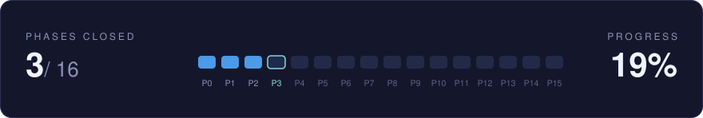

<h1 align="center">
   
  </a>
   
  Dragonfly
   
</h1>

<h4 align="center">A high performance, market-agnostic, quantitative trading system.
</h4>

 —

  <a href="#key-features">Key Features</a> •
  <a href="#documentation">Documentation</a> •
  <a href="#toolchain">Toolchain</a> •
  <a href="#status">Status</a> •
  <a href="#license">License</a>

 

## Key Features

Six layers run as separate processes and communicate over a message bus. Each layer owns one stage
of the path from market data to an executed trade.

| Layer | Name | Job | Language |
| ------ | ------------- | ------------------------------------------------------------ | ------------ |
| **L1** | Ingestion | Turns venue data into normalized messages and keeps the book | C++ |
| **L2** | Strategy | Turns market observations into trading intentions | C++ / Python |
| **L3** | Risk | Approves or rejects each intention | C++ |
| **L4** | OMS | Records positions, cash, orders, and P&L | C++ |
| **L5** | EMS | Sends orders to the venue and reports the outcomes | C++ |
| **L6** | Observability | Shows what is happening and lets a human stop it | Python / TBD |

## Documentation

| Document | Read it for |
| ------------------------------------------ | ------------------------------------------------------------------------------------- |
| [`docs/overview.md`](docs/overview.md) | The runtime picture: layers, processes, channels, and one tick end to end. Start here |
| [`docs/layers.md`](docs/layers.md) | What each layer does, what it must not do, and how it fails |
| [`docs/contracts.md`](docs/contracts.md) | The message set: every field of every message, and the conventions they follow |
| [`docs/lifecycle.md`](docs/lifecycle.md) | Three worked flows: a tick, an order, and a restart |
| [`docs/operations.md`](docs/operations.md) | How to build and run, and the configuration files |
| [`docs/phases.md`](docs/phases.md) | The implementation plan: sixteen phases, what each delivers, and what each one proves |
| [`docs/decisions.md`](docs/decisions.md) | Why the system is built this way, one decision per entry |

If you read one document, read `docs/overview.md`.

## Toolchain

| Concern | Choice |
| ------------ | -------------------------------- |
| C++ compiler | Clang 22 |
| Standard | C++20 |
| Meta-build | CMake, driven by presets |
| Build tool | Ninja |
| C++ packages | vcpkg, manifest mode |
| Host tools | `pkg-config`, `clang-tidy`, `clang-format` |
| Python | 3.11 or later, managed with `uv` |
| Testing | GoogleTest |
| Benchmarking | Google Benchmark |

To build, run or test the codebase, see `docs/operations.md`,

## Status

  

  
  
  

P0 to P2 are closed: the contract, the fixed-point arithmetic, and the clock. P3 is open, and it
builds the runtime, the transport over Aeron, and the recorder. What each phase proves is in
`docs/phases.md`.

## License

[`LICENSE`](LICENSE)

